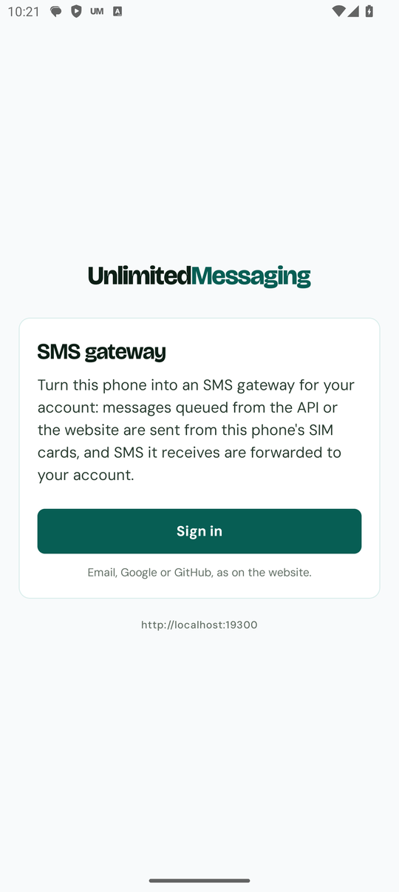
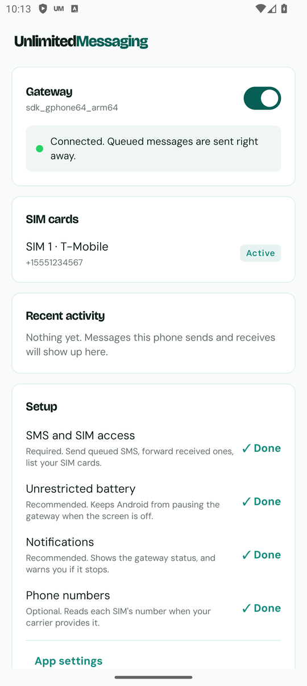
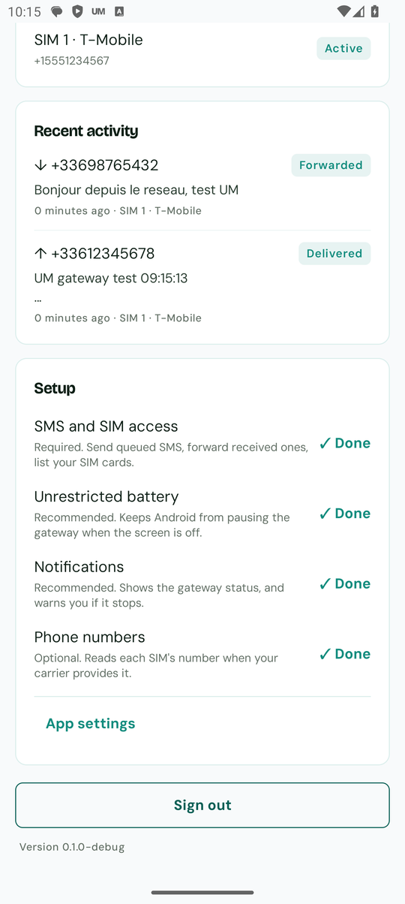

<!-- um-header:start (shared across UnlimitedMessaging repos, keep in sync) -->
<p align="center">
  <a href="https://unlimitedmessaging.app?utm_source=github&utm_medium=readme&utm_campaign=unlimited-messaging-android"></a>
</p>

<h1 align="center">Unlimited Messaging · Android SMS gateway</h1>

<p align="center">
  <b>WhatsApp, email and SMS from your own number, mailbox and Android phone, in one API request.</b><br>
  Free plan, unlimited messages. REST API, SDKs, n8n and an MCP server for Claude, ChatGPT and Cursor.
</p>

<p align="center">
  <a href="https://unlimitedmessaging.app?utm_source=github&utm_medium=readme&utm_campaign=unlimited-messaging-android"></a>
  <a href="https://app.unlimitedmessaging.app?utm_source=github&utm_medium=readme&utm_campaign=unlimited-messaging-android"></a>
  <a href="https://docs.unlimitedmessaging.app"></a>
  <a href="https://unlimitedmessaging.app/mcp?utm_source=github&utm_medium=readme&utm_campaign=unlimited-messaging-android"></a>
  <a href="https://unlimitedmessaging.app/pricing?utm_source=github&utm_medium=readme&utm_campaign=unlimited-messaging-android"></a>
  <a href="https://www.npmjs.com/package/@unlimited-messaging/sdk"></a>
  <a href="https://pypi.org/project/unlimited-messaging"></a>
  <a href="https://discord.gg/danrEJV5Xx"></a>
  <a href="https://x.com/unlimitedmess"></a>
</p>

**Unlimited Messaging projects**

| Project | What it is |
| --- | --- |
| [unlimited-messaging-mcp](https://github.com/UnlimitedMessaging/unlimited-messaging-mcp) | Hosted MCP server for Claude, ChatGPT, Cursor and any MCP client: setup guide and ready-to-paste configs |
| [unlimited-messaging-sdk](https://github.com/UnlimitedMessaging/unlimited-messaging-sdk) | OpenAPI spec, official TypeScript and Python SDKs, and the n8n node source |
| **[unlimited-messaging-android](https://github.com/UnlimitedMessaging/unlimited-messaging-android)** (this repo) | Open source Android app: send and receive SMS from your own phone and SIM |
| [n8n-nodes-unlimited-messaging](https://www.npmjs.com/package/n8n-nodes-unlimited-messaging) | n8n community node for WhatsApp, email and SMS workflows, no code |
| [unlimitedmessaging.app](https://unlimitedmessaging.app?utm_source=github&utm_medium=readme&utm_campaign=unlimited-messaging-android) | Website, web app, pricing and guides |

<!-- um-header:end -->


<h2 align="center">Unlimited Messaging for Android</h2>

<p align="center">
  <b>Send and receive SMS from your own phone, through an API.</b><br>
  Turn an Android phone into an SMS gateway for your <a href="https://unlimitedmessaging.app">Unlimited Messaging</a> account.
</p>

<p align="center">
  <a href="https://github.com/UnlimitedMessaging/unlimited-messaging-android/releases/latest"></a>
  <a href="https://github.com/UnlimitedMessaging/unlimited-messaging-android/actions/workflows/release.yml"></a>
  
  <a href="LICENSE"></a>
</p>

<p align="center">
  
  &nbsp;
  
  &nbsp;
  
</p>

## What it is for

Messages you queue with the Unlimited Messaging API, the dashboard, the SDKs or
the [MCP server](https://github.com/UnlimitedMessaging/unlimited-messaging-mcp)
(`https://mcp.unlimitedmessaging.app`, for Claude, ChatGPT, Cursor...) are sent **as SMS from your phone's
SIM card**, on your own plan, and the SMS your phone receives come back to your
account and your webhooks.

- **Your number, your plan.** Recipients see your number. No third-party SMS
  provider, no per-message fee on top of your carrier's.
- **Dual SIM.** Each SIM becomes its own account; you pick which one sends.
- **Real statuses.** Queued, sending, sent, delivered (when your carrier sends
  delivery reports), undeliverable, failed. SMS has no read receipts, so there
  is no "read".
- **Two-way.** SMS received after you sign in are forwarded to your account,
  with the `message.received` webhook.
- **Sign in like on the website.** Email and password, magic link, Google or
  GitHub, on the website's own page: the app never sees your password.
- **No Google services required.** No Firebase, no Play Services, no
  analytics, no tracking, no ads.
- **Open source**, so you can check exactly what an app holding SMS
  permissions does with them.

Typical uses: appointment reminders and OTP codes sent from your business
number, an AI agent texting from your phone, replies from customers landing
in the same inbox as your WhatsApp and email.

## Install

The app is distributed here, not on Google Play: Play only allows SMS access
for the phone's default SMS app.

1. On your phone, download the latest APK:
   **[unlimited-messaging.apk](https://github.com/UnlimitedMessaging/unlimited-messaging-android/releases/latest/download/unlimited-messaging.apk)**
   (all versions on the [releases page](https://github.com/UnlimitedMessaging/unlimited-messaging-android/releases)).
2. Open it. Android asks to allow installing apps from your browser or file
   manager: allow it for that app only.
3. Open **Unlimited Messaging**, tap **Sign in**, and sign in with your
   Unlimited Messaging account.
4. Go through the setup checklist on the home screen (below).

Requirements: Android 8.0 or newer, a SIM card that can send SMS, an
[Unlimited Messaging](https://unlimitedmessaging.app) account (the free plan
works; its messages end with a short "Sent with UnlimitedMessaging.app" line,
as on the other channels).

Updates install over the previous version: download the new APK and open it.

## Send your first SMS

Once the home screen says **Connected**, your SIM appears as an `SMS` account
in the dashboard and in `GET /account`. Send through it like any other
channel:

```sh
curl https://api.unlimitedmessaging.app/message \
  -H "Authorization: Bearer $UM_API_KEY" \
  -H "Content-Type: application/json" \
  -d '{
        "to": { "phone": "+33612345678" },
        "channels": [{ "channel": "SMS" }],
        "text": "Your appointment is tomorrow at 10:00."
      }'
```

With several SIMs, name the one to use with `"accountId"` in the channel
entry. Statuses and webhooks work exactly as for WhatsApp and email.

## How it works

```text
 your code / dashboard / MCP           Unlimited Messaging API              this app
 POST /message  ─────────────────────►  queues the SMS  ◄──── long poll ──── gateway service
 (channel: SMS)                                         ─────► message ────► SIM card ──► recipient
                                        status, webhook ◄──── SENT / DELIVERED
 webhook message.received  ◄─────────  stores the SMS  ◄──── upload ◄────── SMS received
```

The phone keeps one request open to the API. When a message is queued for one
of its SIMs, the API answers at once, the phone sends it, then reports each
status as the network confirms it. Reports and received SMS are stored on the
phone until the API acknowledges them, so nothing is lost when the network
drops. [docs/ARCHITECTURE.md](docs/ARCHITECTURE.md) has the details.

## Permissions

Every permission the app requests, and why:

| Permission | Required | What it is used for |
| --- | --- | --- |
| Send SMS (`SEND_SMS`) | Yes | Sending the messages queued for your SIM cards. |
| Receive SMS (`RECEIVE_SMS`) | Yes | Forwarding the SMS you receive to your account. Only messages that arrive after you sign in; the SMS already on your phone are never read. |
| Phone state (`READ_PHONE_STATE`) | Yes | Listing your SIM cards (carrier, slot) so each becomes an account. |
| Phone numbers (`READ_PHONE_NUMBERS`) | No | Reading each SIM's own number, when your carrier provides it, so the dashboard shows it. |
| Notifications (`POST_NOTIFICATIONS`) | Recommended | The gateway's status notification, and a warning if it stops. |
| Ignore battery optimizations | Recommended | Keeping the gateway running when the screen is off (see below). |
| Foreground service, start at boot, wake lock, network | Automatic | Staying connected in the background, coming back after a reboot, keeping the phone awake while it hands a message to the radio. |

## Keeping it running

Android stops background apps to save battery. The app runs a foreground
service (that is the permanent notification) and restarts itself after a
reboot, but two settings make the difference, and the home screen links to
both:

- **Unrestricted battery** for the app.
- On Samsung, Xiaomi, Huawei, Oppo, Vivo and a few others: the manufacturer's
  own **auto-start / background** setting.
  [dontkillmyapp.com](https://dontkillmyapp.com) documents each brand.

Good to know:

- Android asks for confirmation when an app sends more than 30 SMS in 30
  minutes. The API spaces SMS out to stay under it.
- Consumer plans with "unlimited SMS" usually forbid automated bulk sending.
  The gateway is meant for your own traffic at a human pace, not campaigns.
- Not every carrier sends delivery reports: a message staying *Sent* is
  normal.

[docs/RELIABILITY.md](docs/RELIABILITY.md) covers all of this in depth.

## Privacy

What leaves the phone, and only towards the Unlimited Messaging API:

- the device's model and name, and the app version;
- for each SIM: carrier name, slot, country and, when available, number;
- the result of each message the gateway sends;
- the SMS received **after you sign in** (sender, text, time).

What stays on the phone: the session (encrypted with a key held by the Android
Keystore) and the list of the last 200 messages the gateway handled, shown on
the home screen. Both are deleted when you sign out. Backups are disabled.

Nothing else: no analytics, no crash reporting service, no ads, no
third-party SDK.

## Verify the APK

Every release is built and signed by the [release workflow](.github/workflows/release.yml)
from the commit it is tagged on, and lists its SHA-256. The signing
certificate's SHA-256 fingerprint is:

```text
16:4E:17:28:5F:7F:04:2C:E4:FB:7B:36:9A:31:7F:50:D5:C1:DE:1F:48:15:6D:11:92:1A:1E:54:CB:2C:05:24
```

Check a downloaded APK with `apksigner verify --print-certs unlimited-messaging.apk`,
or with an app such as AppVerifier.

## Build from source

```sh
git clone https://github.com/UnlimitedMessaging/unlimited-messaging-android.git
cd unlimited-messaging-android
./gradlew assembleDebug
```

Requires JDK 17+ and the Android SDK (platform 35).
[docs/DEVELOPMENT.md](docs/DEVELOPMENT.md) explains how to run it against a
local backend and how to test SMS on the emulator.

## Documentation

| Document | For |
| --- | --- |
| [ARCHITECTURE.md](docs/ARCHITECTURE.md) | How the app is built, and why. |
| [API_CONTRACT.md](docs/API_CONTRACT.md) | Exactly what the app expects from the server. |
| [RELIABILITY.md](docs/RELIABILITY.md) | Background execution, battery, Android and carrier limits. |
| [DEVELOPMENT.md](docs/DEVELOPMENT.md) | Building, running, testing. |
| [RELEASING.md](docs/RELEASING.md) | How releases are built, signed and published. |

## Contributing

Issues and pull requests are welcome, see [CONTRIBUTING.md](CONTRIBUTING.md).
Report security issues privately, see [SECURITY.md](SECURITY.md).

## License

[MIT](LICENSE). The bundled fonts, Bricolage Grotesque and DM Sans, are under
the SIL Open Font License ([licenses/](licenses/)).
