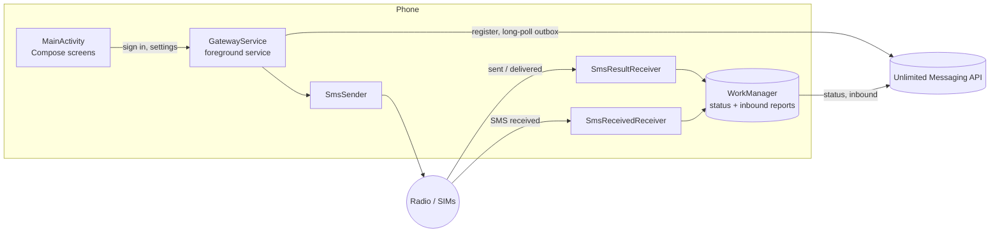
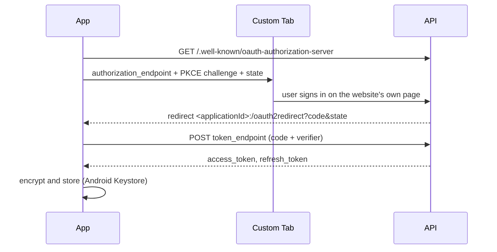
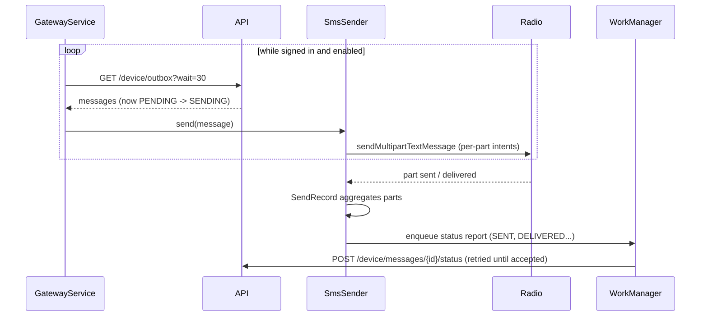

# Architecture

The app is a thin client: it signs in, keeps a connection to the backend,
sends what it is told to send, and reports what happened. Every decision
about *what* to send (pacing, plans, validation, retries across devices) is
made by the server.

## Overview

## Flows

### Sign-in

The app never draws a login form: whatever the website supports (password,
magic link, Google, GitHub), the app supports. The PKCE verifier and state
are persisted while the browser is open, since Android may kill the app in
the meantime.

### Sending

### Receiving

`SmsReceivedReceiver` gets the system broadcast for every incoming SMS (the
phone's SMS app still gets it too), regroups the parts of long messages,
computes a dedup key, and enqueues an `InboundSmsWorker`. Only messages that
arrive after sign-in are forwarded.

## Components

| Package | What lives there |
| --- | --- |
| `auth/` | `AuthRepository` (session state, sign-in, refresh, sign-out), `OAuthClient` (HTTP side of OAuth), `Pkce`, `TokenStore` (Keystore-encrypted session), `OAuthRedirectActivity`. |
| `api/` | `ApiClient` (OkHttp, bearer token, refresh on 401, coroutine cancellation), `DeviceApi` (the `/device/*` endpoints), `Models` (bodies, mirrored in [API_CONTRACT.md](API_CONTRACT.md)). |
| `service/` | `GatewayService` (the loop), `GatewayController` (single decision point for running or not), `GatewayStatus` (observable state), `GatewayNotifications`, `BootReceiver`, `Backoff`. |
| `sms/` | `SmsSender`, `SendRecord` (pure per-part aggregation), `SendTracker` (persistence and idempotency), `SmsResultReceiver`, `SmsReceivedReceiver`, error codes and delivery report decoding. |
| `sim/` | `SimInventory`: active SIMs, their numbers when available, change notifications. |
| `work/` | `StatusReportWorker`, `InboundSmsWorker` (durable uploads), `WatchdogWorker` (restarts a killed service). |
| `system/` | Runtime permissions and background settings (battery exemption, manufacturer screens). |
| `data/` | `GatewayPreferences`, `ActivityLog` (local list of recent messages). |
| `ui/` | One activity, two Compose screens, a view model. `theme/` holds the Unlimited Messaging identity (colors, Bricolage Grotesque and DM Sans, 8dp shapes), `components/` the shared card, buttons and wordmark. |
| `AppContainer` | Hand-wired dependencies, one instance of each per process. |

## Design choices

**Long-polling, no push service.** FCM would need Google Play Services and a
Firebase project, and would make the server push to devices. Long-polling
works on any Android phone, keeps the server stateless (any instance can
answer any poll), and is close to instant. The cost is a foreground service,
which Android requires anyway to keep a background connection alive.

**Durable reports in WorkManager.** A status or an inbound SMS must reach the
server even if the app is killed, the phone reboots, or the network is down
for hours. WorkManager persists the work and retries it with backoff once a
network is available. Unique work names make enqueuing the same report twice
a no-op.

**Idempotency on both sides.** The phone never sends the same message id
twice (`SendTracker`), and the server ignores duplicate reports and inbound
messages (`dedupKey`). Retries are therefore always safe.

**Per-part aggregation as a pure function.** `SendRecord` turns Android's
per-part callbacks into message-level transitions. It has no Android
dependency and is unit-tested exhaustively; `SendTracker` only persists it.

**No database.** Three small stores cover everything: the session (encrypted
SharedPreferences), the send records (SharedPreferences, 7-day retention),
and the activity list (a JSON file, 200 entries). A database would add a
dependency and migrations for no gain.

**No DI framework, no networking framework.** The object graph is a dozen
classes; OkHttp plus kotlinx.serialization replace Retrofit in a hundred
lines. Fewer dependencies is also fewer things to audit in an app that holds
SMS permissions.
